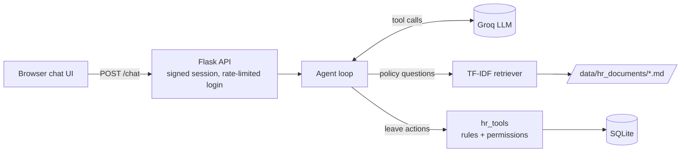

# HR Agent

[](https://github.com/HarshMaurya14/HR-Agent-/actions)

An AI assistant for employees and managers. It answers HR policy questions from your own documents (with citations) and handles leave requests, with the business rules and permissions enforced in code rather than left to the language model.

<!-- Add a screenshot or GIF here: docs/demo.png -->

## What it can do

**Employees**
- Ask about policies, benefits, insurance, working hours, payroll or remote work. Answers cite the source file, e.g. `(Source: leave_policy.md)`.
- Check leave balances, including days already held by pending requests.
- Request leave in natural language ("sick leave from Tuesday to Thursday"). It asks for missing details and confirms before saving.
- List and cancel their own pending requests.

**Managers**
- See pending requests from their direct reports.
- Approve or reject them, with the balance deducted automatically.

## How it works



The model decides *which tool to call*. Everything that matters is decided by code:

| Concern | How it is handled |
|---|---|
| **Who is the user?** | Taken from the signed session cookie. The model has no `employee_id` parameter, so it cannot act for anyone else (covered by a test). |
| **Permissions** | Manager-only tools are not shown to employees, *and* the underlying functions re-check the role. Managers can only decide requests from their own direct reports and never their own. |
| **Accidental changes** | `apply / cancel / approve / reject` first run a dry-run validation, then ask **"Reply yes to confirm"**. Nothing is written until the user confirms, and the confirmation text is generated from validated data, not model output. |
| **Wrong policy answers** | The model must answer from retrieved policy text and cite the file. No match means "I couldn't find that", not a guess. |
| **Prompt injection** | Tool output is treated as data in the system prompt, and the model can't reach any capability that isn't an explicit, validated tool. |
| **Race conditions** | Writes run inside one SQLite transaction (`BEGIN IMMEDIATE`), so a double-approval can't deduct a balance twice. |
| **Passwords & sessions** | Passwords are salted hashes (`scrypt`, via Werkzeug). Failed logins are rate-limited, the session is renewed on login, and cookies are `HttpOnly` + `SameSite=Lax`. |

### Leave rules

- Only **working days** count (Mon-Fri, minus the company holidays in `data/holidays.json`).
- Pending requests are counted against the balance, so you can't stack requests beyond what you have.
- Overlapping requests are rejected; leave can't start in the past.
- Policy-based warnings: annual leave needs 7 days' notice, casual leave 1 day (shown when confirming).
- *Assumptions I made where the policy is silent:* sick leave may be reported up to 3 days late, and one request can span at most 90 days. Both are constants in `src/config.py`.

## Quick start

```bash
git clone https://github.com/HarshMaurya14/HR-Agent-.git
cd HR-Agent-
python -m venv .venv && source .venv/bin/activate     # Windows: .venv\Scripts\activate
pip install -r requirements.txt

cp .env.example .env        # then add your GROQ_API_KEY (free at console.groq.com) and a SECRET_KEY
python api.py               # open http://127.0.0.1:5000
```

The database is created and seeded with demo employees on first run. Prefer the terminal? `python main.py EMP001` opens a CLI chat.

### Demo accounts (demo data only)

| ID | Password | Role |
|---|---|---|
| `EMP001` | `harsh123` | Employee (reports to EMP003) |
| `EMP002` | `rahul123` | Employee (reports to EMP003) |
| `EMP003` | `priya123` | Manager |

Set `SEED_DEMO_DATA=0` to hide the demo logins and skip seeding. **Never deploy with the demo accounts.**

### Example (confirmation messages are real output from the code)

> **Harsh:** I want annual leave from Tuesday to Thursday
>
> **Assistant:** Please confirm: submit **Annual Leave, Tue 10 Nov 2026 to Thu 12 Nov 2026 (3 working days)**?
> - Note: Policy asks for 7 days' notice for annual leave, so your manager may decline.
> Reply **yes** to confirm or **no** to cancel.
>
> **Harsh:** yes
>
> **Assistant:** ✅ Leave request **#1** submitted: Annual Leave, Tue 10 Nov 2026 to Thu 12 Nov 2026 (3 working days). Status: **Pending** your manager's approval.

> **Priya (manager):** approve request 1 -> *confirm* -> ✅ Approved leave request #1 from Harsh Maurya... Days deducted: **3**, remaining Annual Leave: **9**

## Tests

```bash
pip install -r requirements-dev.txt
pytest
```

96 tests run in about 3 seconds with **no API key or network**: the agent tests use a scripted fake model. They cover the leave rules, every permission boundary, the confirmation flow, session handling and login rate-limiting, the LLM client (mocked HTTP, retries, errors), and a small retrieval benchmark (each policy question must return the right document). CI runs them on Python 3.10-3.12.

## Project layout

```
api.py              Flask app factory: login, sessions, /chat
main.py             CLI chat
src/
  agent.py          tool-calling loop, confirmation flow, role-based tool lists
  hr_tools.py       leave rules and permission checks (no LLM involved)
  retriever.py      in-memory TF-IDF index over data/hr_documents/*.md
  llm.py            Groq client with retry and clear errors
  database.py       schema + connections     seed.py   demo data
  auth.py           password hashing         config.py settings
data/
  hr_documents/     policy markdown (edit these to change what the bot knows)
  holidays.json     company holidays excluded from leave day counts
templates/          login + chat UI
tests/              pytest suite
```

To change the bot's knowledge, edit or add `.md` files in `data/hr_documents/` (use `##` headings to split sections) and restart. There is no ingestion step.

## Configuration

| Variable | Purpose | Default |
|---|---|---|
| `GROQ_API_KEY` | LLM access | required for chat |
| `GROQ_MODEL` | Any Groq model with tool calling | `openai/gpt-oss-20b` |
| `SECRET_KEY` | Signs session cookies | random per start (logins reset on restart) |
| `SEED_DEMO_DATA` | Seed demo employees, show demo logins | `1` |
| `SESSION_COOKIE_SECURE` | Set to `1` when serving over HTTPS | `0` |
| `FLASK_DEBUG` | Debug mode, never in production | `0` |
| `HR_DB_PATH` | SQLite file location | `data/hr_database.db` |

## Known limitations

- **Conversation state is in memory** (history and pending confirmations), so it works for one server process. For multiple workers, move it to Redis or the database.
- **SQLite** is perfect for a demo; use Postgres for real multi-user load.
- **TF-IDF retrieval** handles the small policy set well but doesn't understand synonyms. Swapping in embeddings is the natural next step; `PolicyIndex.search` is the only function to replace.
- Users are provisioned by seed script. There is no admin UI, password reset or SSO.
- Serve behind HTTPS (and a real WSGI server such as gunicorn) for any non-local use.

## Roadmap ideas

- Embedding-based retrieval with a retrieval-quality evaluation set
- Email/Slack notification to the manager when a request is submitted
- Cancel approved leave with balance restoration
- Admin page for managing employees and holidays
